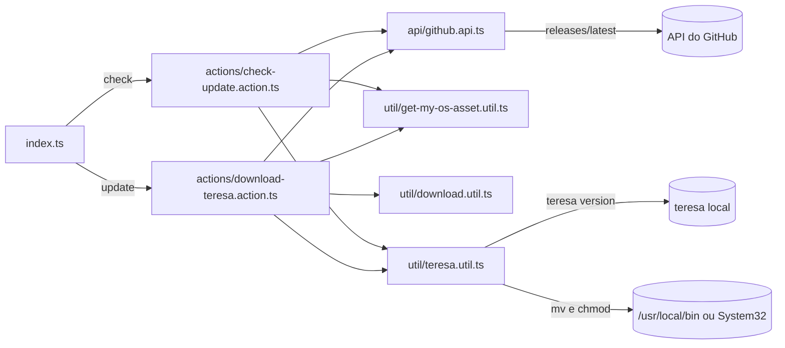

<div align="center">


# Teresinha

**Interface de linha de comando que checa e atualiza o cliente do [Teresa](https://github.com/luizalabs/teresa/).**<br/>
Um comando verifica a última release e outro baixa e instala a versão certa para o seu sistema.

[](https://www.codacy.com/app/jr_acn/teresinha?utm_source=github.com&utm_medium=referral&utm_content=juninmd/teresinha&utm_campaign=badger)
[](https://npmjs.org/package/teresinha)
[](https://npmjs.org/package/teresinha)
[](https://github.com/juninmd/teresinha/actions/workflows/validate.yml)
[](https://github.com/juninmd/teresinha/issues)
[](https://github.com/juninmd/teresinha/network)

</div>

> **Verifica e atualiza o Teresa pelo terminal.** Comece com `teresinha check`; `teresinha update` instala ou atualiza o Teresa.

## Por que Teresinha

Escopo pequeno de propósito: checar e atualizar o `teresa`, e repassar comandos de apps ao próprio `teresa`.

- **Simples.** `check` mostra a versão disponível; `update` cuida do download e da instalação.
- **Multiplataforma.** Escolhe o asset da release para Linux, macOS ou Windows.
- **Em lote.** `start`, `env`, `getAllEnvs` e `setAllEnvs` operam sobre todos os apps ou variáveis de uma vez (ver Limitações para Windows).

## Teresa

O `teresa` é a ferramenta que o Teresinha atualiza: [github.com/luizalabs/teresa](https://github.com/luizalabs/teresa/).

## Instalação

- Requisito: [Node 8+](http://nodejs.org/) (declarado no README original; o `package.json` não define `engines`, e não testamos com Node 8).
- `Linux` ou `Mac`: use o terminal.
- `Windows`: use o cmd ou o PowerShell com privilégios de `Administrador`.

Instale globalmente via `npm` ou `yarn`:

```bash
$ npm install -g teresinha
```

```bash
$ yarn global add teresinha
```

> [!NOTE]
> `update` move o binário para `/usr/local/bin/` (Linux e Mac, com `sudo`) ou `C:\Windows\System32\` (Windows). Sem privilégios elevados a instalação pode falhar.

Para listar os comandos disponíveis:

```bash
$ teresinha --help
```

## Uso

### Comandos do Teresa

```bash
$ teresinha check    # compara a versão local do teresa com a última release
$ teresinha update   # instala o teresa se faltar ou atualiza se a versão local for diferente
```

Saída real de `teresinha check` capturada em 2026-10-23, sem o `teresa` instalado (a versão muda a cada release; as linhas de stack trace que aparecem antes dessas mensagens foram omitidas, ver Limitações):

```text
Você ainda não tem o teresa cli instalado
Informações da última release:
Autor: teresa-bot
Versão: v0.35.0-rc1
Atualize com o comando: $ teresinha update
```

### Comandos de apps

Requerem o `teresa` instalado. `env`, `getAllEnvs` e `setAllEnvs` não estão disponíveis no Windows.

| Comando | O que faz |
|---|---|
| `teresinha start` | executa `teresa app start` para cada app listado por `teresa app list` |
| `teresinha env <app> <caminho-do-.env>` | envia as variáveis do arquivo ao app com `teresa app env-set` (linhas que começam com `#` e vazias são ignoradas) |
| `teresinha getAllEnvs <diretorio>` | grava um arquivo `.env-<app>` por app no diretório, com as variáveis em texto puro |
| `teresinha setAllEnvs <diretorio>` | lê os arquivos do diretório e seta as variáveis em cada app |

Exemplo com um arquivo fictício `./exemplo.env` contendo `EXEMPLO=valor`:

```bash
$ teresinha env meu-app ./exemplo.env
```

## Como funciona



- A última release vem da API pública do GitHub (`luizalabs/teresa`), sem token.
- O asset é escolhido pelo nome do sistema (`windows`, `linux` ou `darwin`).
- A versão local vem de `teresa version`; se o `teresa` não existir, `update` instala direto.
- `update` baixa o binário e o move para o diretório do sistema, com `sudo` no Linux e Mac.

## Desenvolvimento

Requer Node e npm (testado com Node 24.21.0 e npm 11.19.0).

```bash
$ npm install       # instala dependências e configura o hook pre-commit (husky, roda npm run lint)
$ npm run lint      # tslint do projeto
$ npm run build     # compila com tsc e gera index.js; no Windows use Git Bash ou WSL (ver Limitações)
$ node index.js --help  # executa o CLI compilado pelo build
```

## Contribuindo

- Commits no formato `tipo: descrição` (ex.: `chore:`, `security:`), como no histórico do repositório.
- Bugs e sugestões: [issues](https://github.com/juninmd/teresinha/issues).

## Segurança

| Ponto | Situação |
|---|---|
| Download | baixa o asset da release de `luizalabs/teresa` sem checar hash ou assinatura |
| Permissões | `update` usa `sudo` no Linux e Mac para mover o binário e aplica `chmod 755` nele; no Windows usa `move` para `System32`, que exige Administrador |
| Variáveis de app | `getAllEnvs` grava valores em texto puro em `<diretorio>/.env-<app>`; o `.gitignore` deste repositório cobre `.env`, mas não `.env-*` |
| Linha de comando | `env` e `setAllEnvs` passam os valores como argumentos de `teresa app env-set`, visíveis para outros processos enquanto o comando roda |

## Limitações conhecidas

- `env`, `getAllEnvs` e `setAllEnvs` imprimem `Não disponível para Windows`.
- `getAllEnvs` e `setAllEnvs` não foram executados contra um `teresa` real nesta revisão.
- `setAllEnvs` lê todo arquivo do diretório, não só os `.env-<app>`.
- Sem o `teresa` instalado, `check` imprime um stack trace do erro antes da mensagem, porque `util/command.util.ts` registra o erro com `console.log`.
- `npm run build` e `npm test` chamam `./node_modules/.bin/tsc`, que o cmd e o PowerShell não executam; use Git Bash ou WSL.
- `tsc` termina com código 2 por erros em `@types/babel__traverse` (dependência transitiva do jest), mesmo gerando `index.js`.
- `npm test` falha: o jest não encontra testes (`testRegex` aponta para `index.test.ts`, que não existe).
- A API pública do GitHub é consultada sem autenticação, sujeita ao limite de requisições dela.

## Licença

MIT, conforme o campo `license` do `package.json`. Autor: Antonio Carlos.
